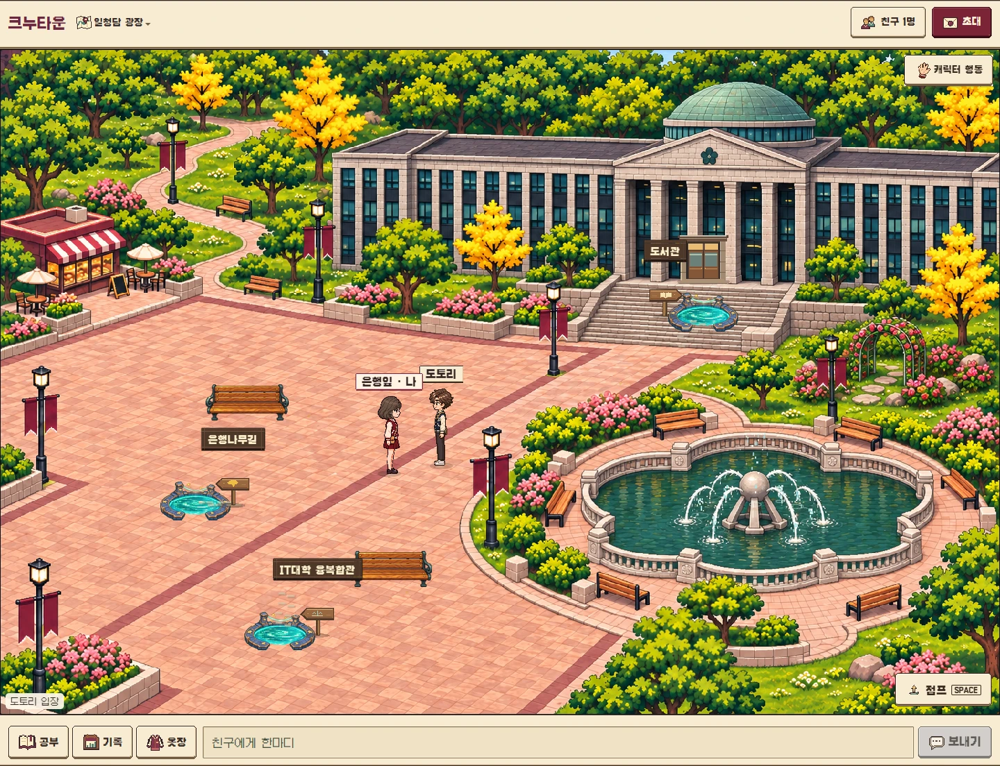
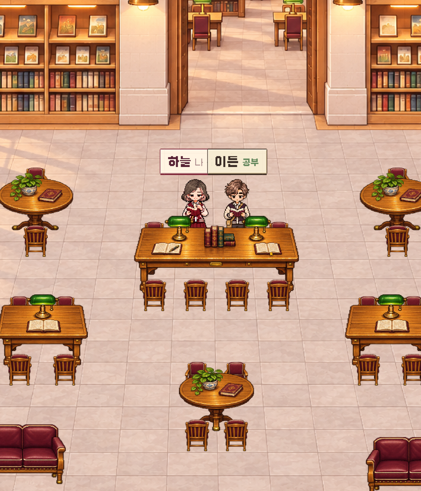
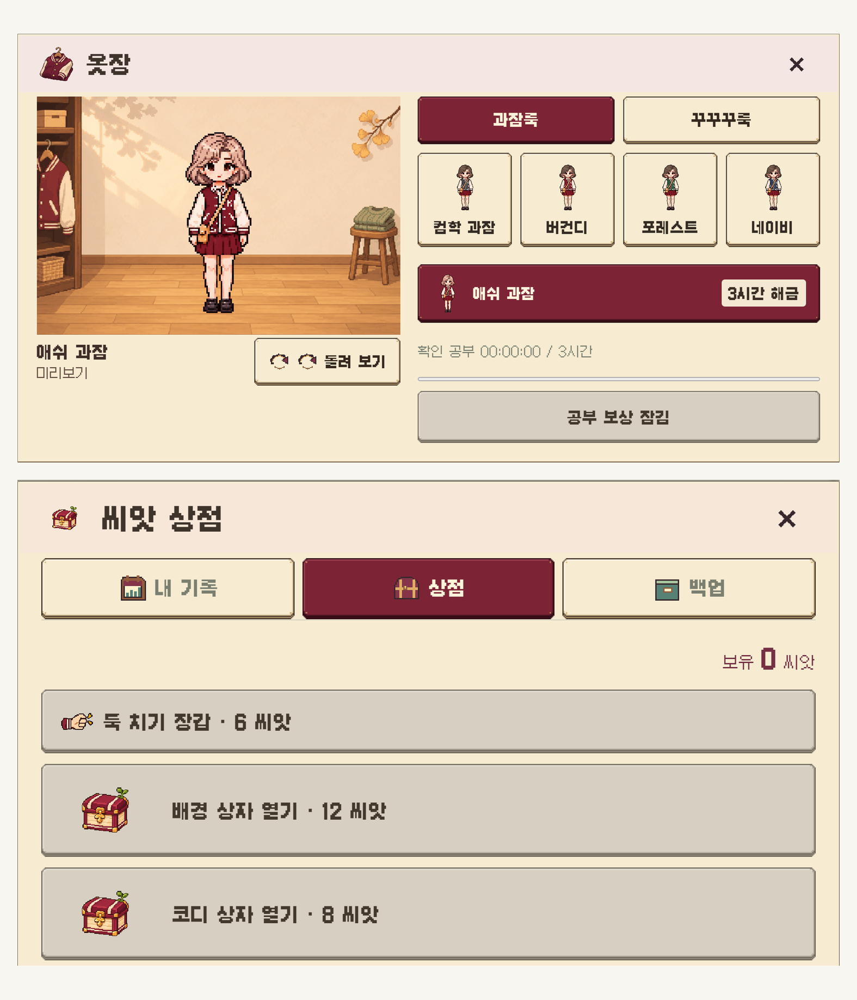

# 크누타운

경북대학교 대구캠퍼스의 일청담 광장에서 친구와 만나고, 중앙도서관에서 함께 공부하는 브라우저 멀티플레이 게임입니다. 한 사람이 노트북에서 방을 열면 같은 네트워크에 있는 참가자는 휴대폰이나 노트북의 브라우저로 들어옵니다.

[컴퓨터학부·도서관과 모바일 화면](docs/play-screens.md) · [교내망 실험과 측정 결과](docs/network-research.md) · [팀이 함께 반영한 기능](docs/team-contributions.md) · [LAN 통신 키트](https://github.com/TaeHuiKKIM/campus-lan-kit)



## 웹 광장 바로 시작하기

휴대폰이나 PC에서 [크누타운 웹 광장 들어가기](https://knu-direct-plaza.vercel.app/?mode=web)를 누르세요. 방장 프로그램을 설치할 필요 없이 브라우저에서 시작할 수 있습니다.

**초대 → 모임 만들기**에서 스터디·학과·동아리·과팅 모임을 열 수 있습니다. 친구는 링크를 통해 모임 내용을 보고 참여합니다. 과팅방에서는 첫 대화를 열 질문을 고를 수 있습니다. 자주 방문한다면 **옷장 → 화면 설정 · 문의 → 홈 화면에 추가**로 웹 앱을 설치할 수 있습니다. iPhone Safari에서는 공유 메뉴의 **홈 화면에 추가**를 사용하세요. [모임과 설치](docs/web-entry.md)

## 친구와 입장하면 이렇게 플레이해요

방장과 친구가 같은 Wi-Fi에 연결하고 **초대** QR로 같은 광장에 들어옵니다. 광장에서 닉네임과 움직임이 서로 보이면 채팅으로 만날 장소를 정하세요.

| 도서관에서 같이 공부하기 | 공부한 시간으로 옷 꾸미기 |
| --- | --- |
|  |  |
| 도서관에서 빈 의자를 누르면 캐릭터가 걸어가 앉습니다. **공부**에서 과목과 목표를 적으면 집중 시간을 기록할 수 있어요. | 확인한 공부 시간 10분마다 씨앗 1개를 얻습니다. 씨앗 8개로 코디 상자를 열고, **옷장**에서 얻은 옷을 입어 보세요. |

왼쪽은 두 브라우저로 같은 LAN 방에 접속해 촬영한 장면입니다. 오른쪽은 같은 버전의 옷장과 상점을 각각 열어 위아래에 배치했습니다.


## 노트북으로 첫 방 열기

오래 열어 두는 방장은 친구가 입장할 때 필요한 진단 기록만 남깁니다. [방장의 접속 로그](docs/operations.md#방장의-접속-로그)

**Windows에서 더블클릭으로 열기**

1. 방장 PC에 [Node.js 22.17 이상](https://nodejs.org/)을 설치하고 [게임 ZIP](https://github.com/TaeHuiKKIM/knu-town-community/archive/refs/heads/main.zip)을 풀어 주세요.
2. Wi-Fi에 연결한 뒤 **START-CAMPUS.cmd**를 더블클릭하고 Windows 권한 창을 승인하세요. 처음에는 필요한 파일을 설치한 뒤 방장 브라우저가 열립니다.
3. 게임의 **초대**에서 친구에게 링크나 QR을 보여 주세요. 참가자는 같은 Wi-Fi에서 브라우저로 접속합니다. 방을 닫을 때는 같은 폴더의 **STOP-CAMPUS.cmd**를 더블클릭하세요.

**터미널에서 열기**

Node.js **22.17 이상**과 Git을 설치한 뒤 아래 명령을 차례로 실행하세요.

```sh
git clone https://github.com/TaeHuiKKIM/knu-town-community.git
cd knu-town-community
npm ci
npm start
```

1. 방장 브라우저에서 [일청담 광장](http://localhost:4183/r/main)을 엽니다. 닉네임과 캐릭터를 선택해 입장하세요.
2. 친구도 같은 Wi-Fi에 연결합니다. 터미널에 표시된 **Wi-Fi 주소**를 보내거나 게임 오른쪽 위 **초대**에서 QR을 보여 주세요. 친구가 자기 휴대폰에서 `localhost`를 열면 그 휴대폰 자신에게 연결됩니다.
3. 두 사람의 캐릭터가 보이면 서로 이동하거나 채팅해 보세요. 방을 운영하는 동안 노트북과 터미널을 켜 둡니다. 종료는 `Ctrl+C`입니다.

기본 포트는 4183입니다. `PORT`로 포트를, `STUDY_BIND`로 수신할 주소를 정할 수 있습니다. 혼자 체험할 때는 PowerShell에서 `$env:STUDY_BIND='127.0.0.1'`을 지정해 실행하세요. 자세한 운영 방법은 [운영과 문제 해결](docs/operations.md)에 있습니다.

## 게임에서 할 수 있는 일

| 장소 또는 메뉴 | 이용 방법 |
| --- | --- |
| 일청담 광장 · 은행나무길 | 키보드 방향키·WASD 또는 화면 조이스틱으로 걸으며 친구를 만납니다. 벤치에 앉거나 인사·점프·감정을 표현합니다. |
| 도서관 라운지 · 열람실 | 도서관 가구에서 상호작용하고, 중앙도서관 열람실에서 빈 자리를 골라 함께 공부합니다. |
| IT대학 융복합관 · IT4호관 · 강의실 | IT5 앞마당에서 **수업 듣기**를 켜면 같은 방 친구가 수업 상태를 볼 수 있습니다. IT4 정문의 **컴퓨터학부** 간판 아래 포털로 들어가면 흰 책상 8개와 의자 24개가 있습니다. |
| 공부 · 기록 · 옷장 | 과목을 정해 공부한 시간을 확인하고 누적 시간으로 의상을 엽니다. 웹판은 닉네임과 착용 코디, 확인 기록, 구매 내역을 한 백업 파일로 옮길 수 있습니다. |
| 친구 광장 | 만든 광장의 링크나 QR을 공유합니다. 메인과 별도로 친구들과 공부하거나 놀 수 있습니다. |
| AI 튜터 | 방장 PC에 호환되는 Ollama 모델을 설치해 실행했을 때 공부 질문을 보낼 수 있습니다. |

장소를 옮길 때는 다음 배경이 준비될 때까지 현재 지도가 보입니다. 한글 키보드로도 방향키·WASD를 사용할 수 있습니다. 휴대폰에서는 빈 의자를 눌러 앉고 채팅 내역을 위로 밀어 지난 대화를 읽습니다. [좌석·채팅 조작 안내](docs/web-entry.md#강의실과-도서관에서-자리-고르기)

LAN 메인 광장 정원은 100명, 친구 광장은 16명, 열람실은 64석입니다. 공개 웹판은 최대 4명의 실험 공간입니다. 행사판의 정원 설정, 노트북에서 모의 참가자 100명으로 측정한 성능, 교내 Wi-Fi에서 실제 팀원 3명이 통신한 기록은 각각 [네트워크 연구](docs/network-research.md)에서 확인할 수 있습니다.

## 개발과 검증

```sh
npm test
npm --prefix online ci
npm --prefix online run build
npm --prefix online run check:install
```

| 위치 | 내용 |
| --- | --- |
| [src](src) · [server.mjs](server.mjs) | 방 입장, 행동 검증, 실시간 상태 전송, 공부 데이터와 튜터 |
| [public/campus](public/campus) | 캠퍼스 지도, 캐릭터, 이동, 옷장, 공부 UI |
| [design/stage1/assets](design/stage1/assets) · [design/character-v3](design/character-v3) | 게임 실행에 사용하는 배경·도구·폰트·의상 시트 |
| [online](online) | 브라우저 간 직접 연결과 웹 연결 모드를 제공하는 별도 웹판 |
| [test](test) · [scripts](scripts) | 기능 회귀 테스트와 제한된 로컬 부하 검사 |
| [docs](docs) | 게임 구성, 운영, 교내망 실험, 저작물별 출처 |

게임 코드의 사용 조건과 폰트·이미지의 조건은 [라이선스](LICENSE.md)와 [출처 안내](docs/credits.md)를 참고하세요. 문의나 재현 가능한 버그는 [Issues](https://github.com/TaeHuiKKIM/knu-town-community/issues)에 남겨 주세요.
