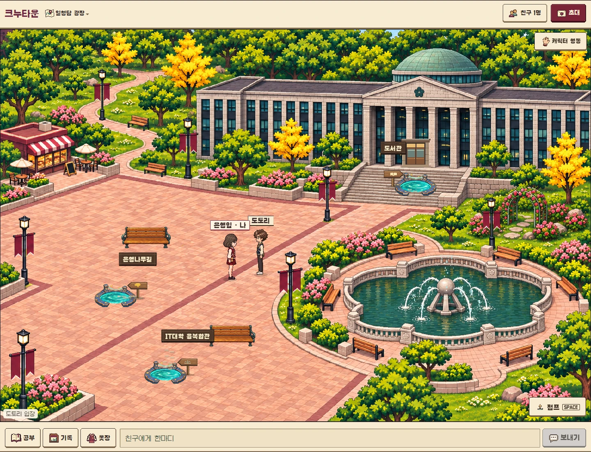
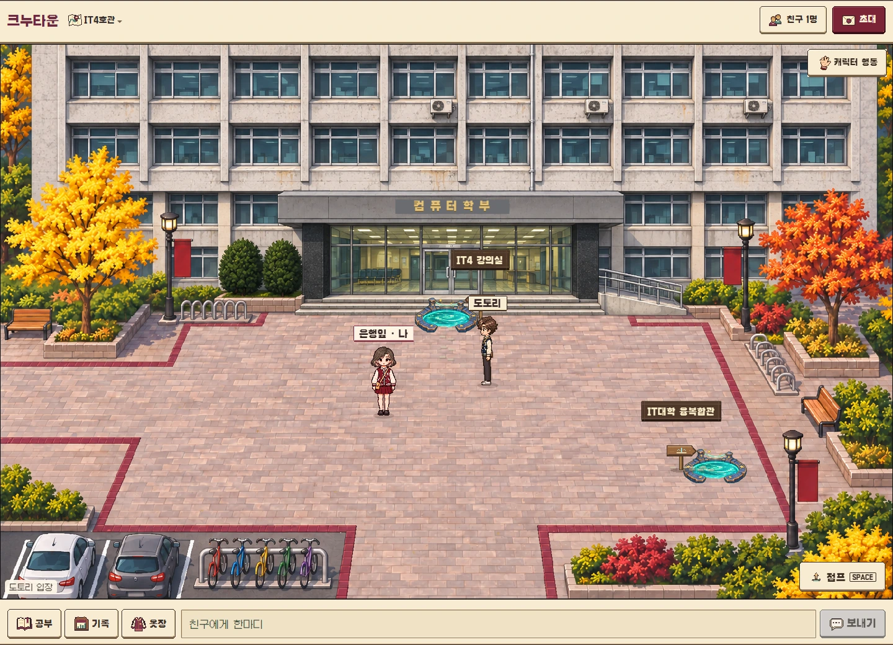
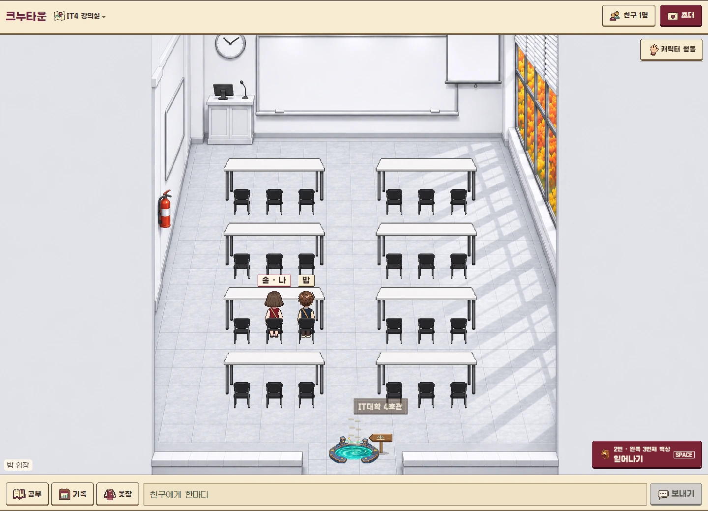
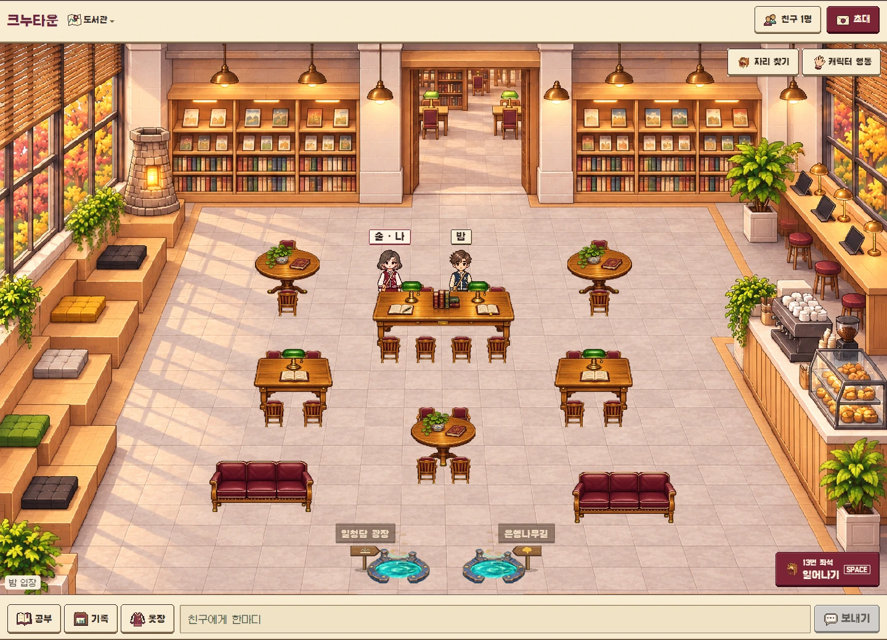
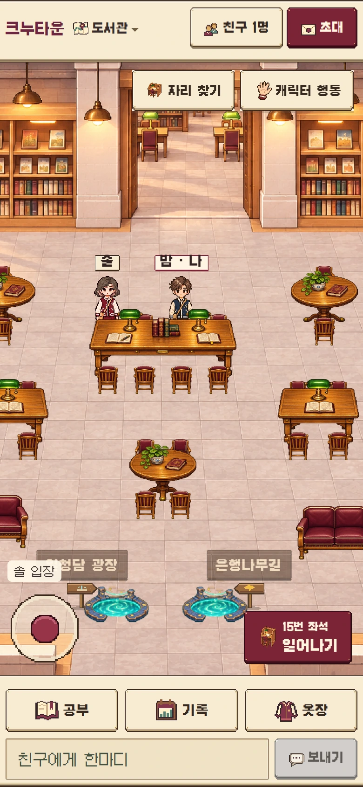
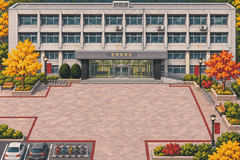
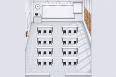
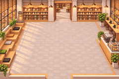

# 캠퍼스 플레이 화면

두 브라우저로 같은 방에 접속해 촬영한 공개 웹판 화면이다. [웹 광장 들어가기](https://knu-direct-plaza.vercel.app/?mode=web)

## 일청담 광장

오른쪽은 일청담, 뒤편은 본관이다. 광장에서 친구를 만나고 이정표를 따라 다른 장소로 걸어간다.

## 컴퓨터학부와 IT4 강의실

IT대학 융복합관 앞마당에서 IT4호관으로 건너간다. 정문 위 **컴퓨터학부** 간판 아래 포털로 들어가 빈 의자를 누르면 친구 옆에 앉을 수 있다.

| IT4 정문 | 강의실 옆자리 |
| --- | --- |
|  |  |

## 도서관

같은 공동 테이블을 PC와 휴대폰 너비에서 촬영했다. 휴대폰에서는 **자리 찾기**로 의자를 고르고, 앉은 뒤 **일어나기**를 누른다.

## 지도에 표시되는 장소 카드

| IT4 정문 | IT4 강의실 | 도서관 |
| --- | --- | --- |
|  |  |  |

게임에서 장소 이동을 열면 이 카드가 보인다. 가구 배치나 간판이 바뀌면 [미리보기 생성 도구](../design/ui-kit/make-scene-previews.py)로 다시 만들 수 있다. 루트와 `online`의 npm 의존성, Chromium, Python의 Pillow를 준비하고 저장소 루트에서 `python design/ui-kit/make-scene-previews.py it4 lecture lounge`를 실행한다.

도서관 공동 책상에서 과목을 기록하고 씨앗으로 코디 상자를 여는 과정은 [LAN 실행 사진 두 장](../README.md#친구와-입장하면-이렇게-플레이해요)에서 확인할 수 있습니다.
